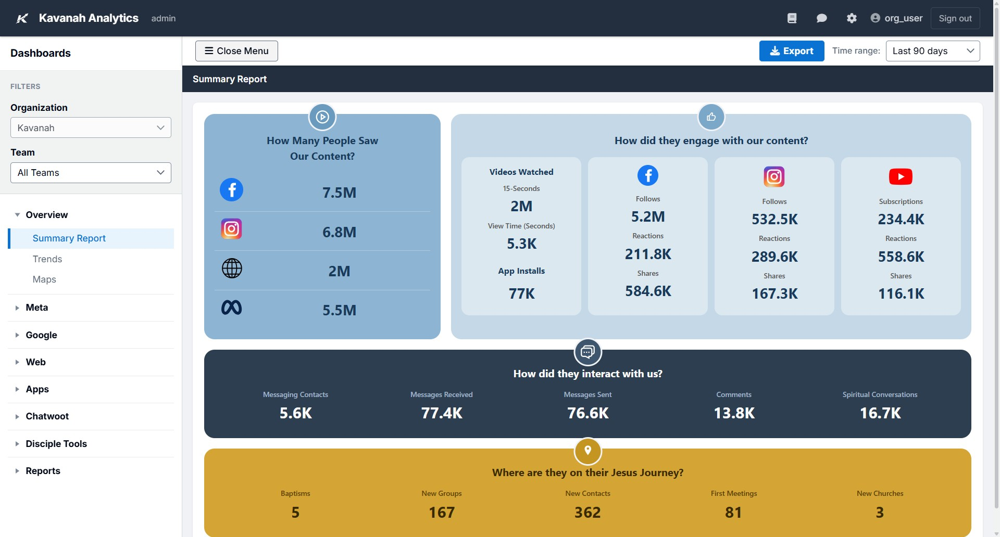
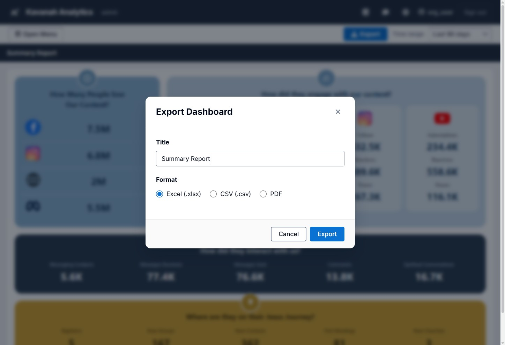
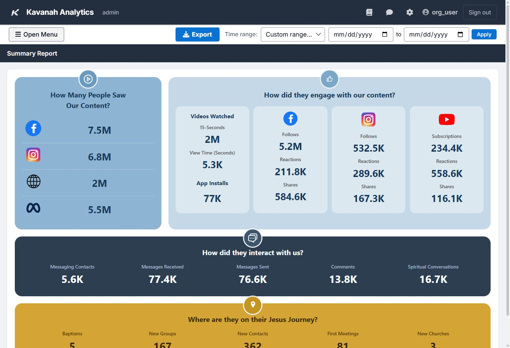
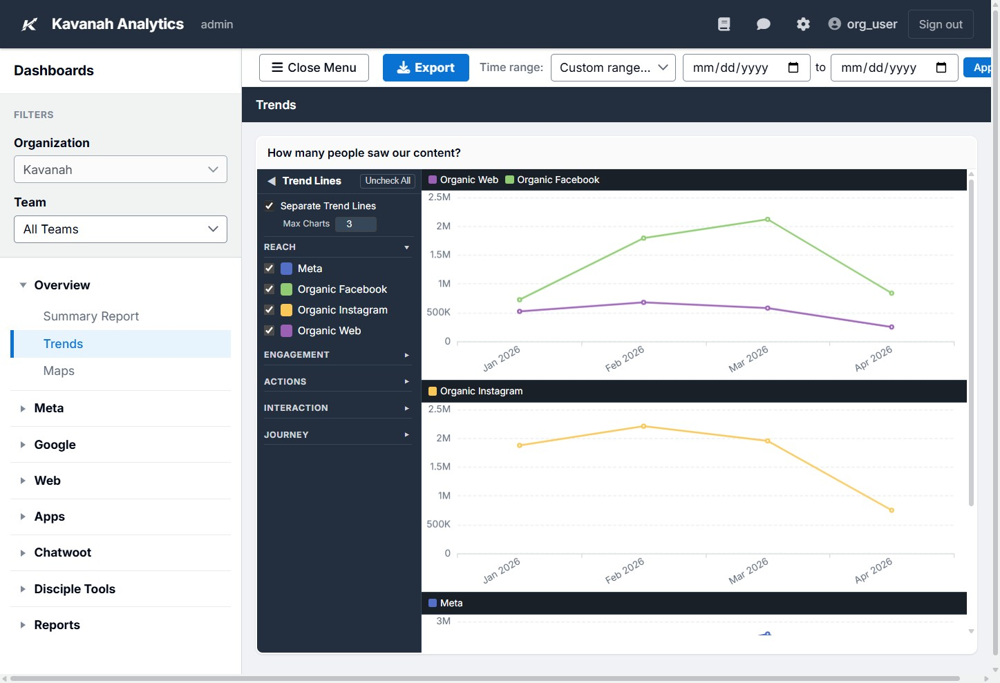
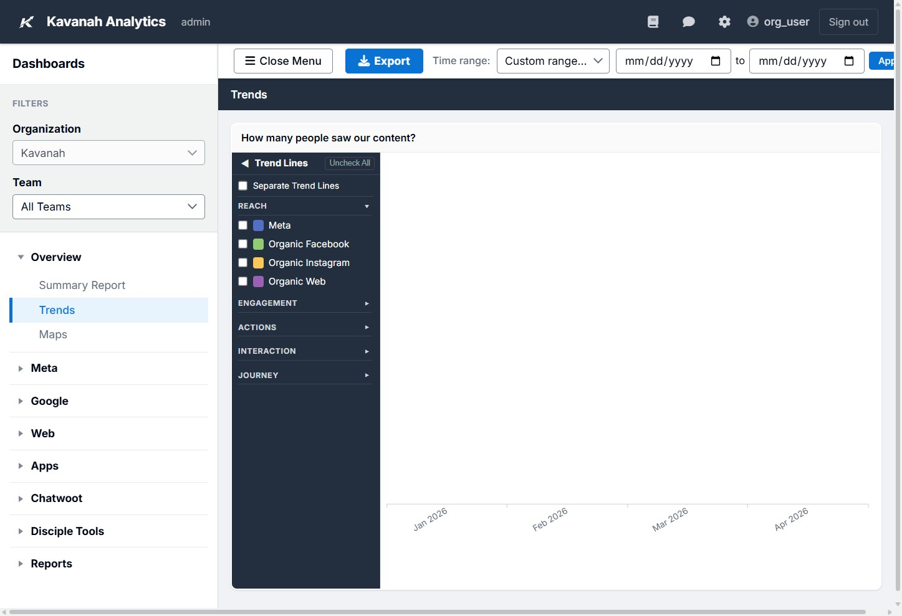
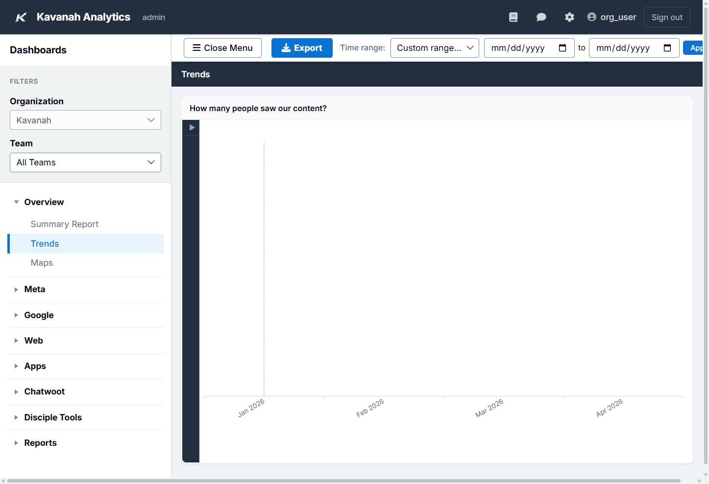
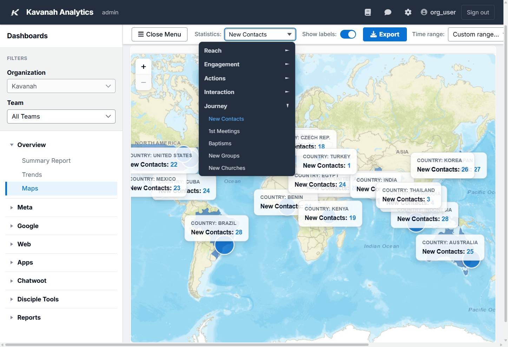
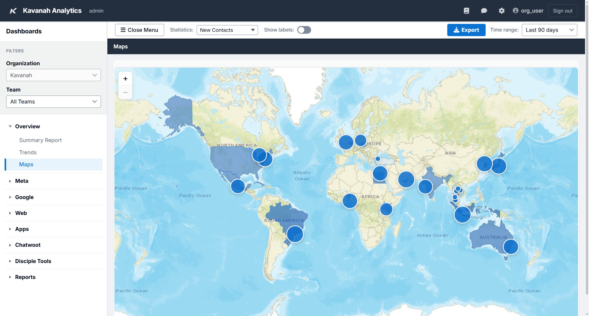
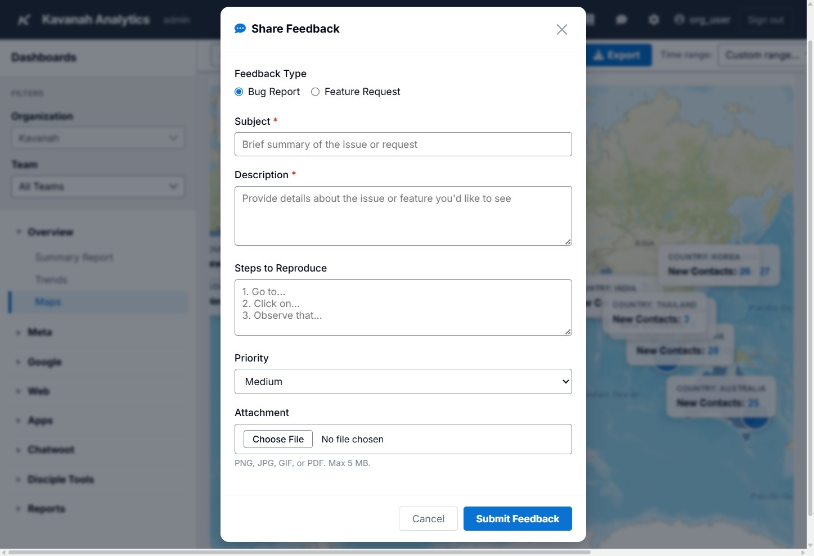

.. _guide-dashboards-overview:

===================
Dashboards Overview
===================

We'll walk you through everything you need to get started — from navigating
the menus to exploring your dashboards and reports.

Filters
-------

If your administrator has enabled them, you'll find **Organization** and
**Team** filters in the left side menu. They let you narrow your data to a
specific group. Depending on your role and setup you may see both, one, or
neither — we'll leave any that appear at their defaults for now.

Menu Overview
-------------

Let's take a look at the main menu on the left side of the screen.

**Overview** — This section includes reports that encompass all of your data
sources.

**Data Source Menus** — Below Overview, you'll see menus for each data source
your administrator has enabled. These may include Meta, Google, YouTube, Echo,
Chatwoot, and Disciple Tools.

**Reports** — This menu contains reports created by your administrator that
are specific to your organization. It only appears if your administrator has
enabled it.

**Close Menu** — Click this button to collapse the menu and give yourself more
room to view dashboards. Click it again to expand the menu.

Toolbar
-------

Above each dashboard, you'll find a few useful controls:

**Export** — You can export any report to Excel, CSV, or PDF.

**Time Range** — Use this filter to narrow any dashboard to a specific time
range. You can choose from preset options (Last 7 days, Last 30 days,
Last 90 days, Last 6 months, Last 12 months) or set a custom range. Custom
ranges accept dates from your earliest data through today — future dates
and end-before-start ranges are blocked.

**Publish** *(Impact Reports only)* — Generates a unique public URL you
can share with supporters who don't have a Kavanah login. The button only
appears on dashboards that meet the publish requirements; see
:doc:`sharing-reports` for the full walkthrough.

Maintenance banner
~~~~~~~~~~~~~~~~~~

Occasionally you'll see a coloured banner pinned to the top of the page —
this is a maintenance alert posted by an administrator (e.g. for a
planned upgrade or a known issue). You can dismiss it from your own
session; it'll come back if the administrator publishes a new message.

Overview: Summary Report
------------------------

The Summary Report gives you a high-level view of results across all your data
sources. It's organized around four questions:

- **How many people saw our content?** — Reach metrics across your platforms.
- **How did they engage with our content?** — Includes video views, app
  installs, follows, subscriptions, reactions, and shares.
- **How did they interact with us?** — Conversations captured from Echo or
  Chatwoot, plus social media comments.
- **Where are they on their Jesus Journey?** — Journey data from Disciple
  Tools.

Overview: Trends
----------------

The Trends report lets you compare metrics side by side over a specific time
range. Metrics are grouped into five categories: Reach, Engagement, Actions,
Interaction, and Journey. Reach is selected by default.

**Customizing the view:**

Check the **"Separate Trend Lines"** box to display each metric on its own
chart with an independent Y-axis — this makes it easier to spot trends when
metrics have very different scales.

Uncheck it to view all trend lines on a single chart.

Use the **"Uncheck All"** button to clear all selected trend lines.

Click the arrow next to the Trend Lines heading to collapse that panel.

Overview: Maps
--------------

The Maps view displays your metrics geographically. You can zoom in and
out using the scroll wheel or the +/– buttons. The map opens centred
on **Meta Reach** by default; switch metrics from the **Statistics**
dropdown.

Use the **Statistics** dropdown to choose from the same five metric
categories available in Trends. Expand a category and select a metric
to display results on the map.

Each metric is rendered as three layers stacked on top of each other:

- **Country dots** — sized by the metric value
- **Region polygons** *(admin-1 / states / provinces)* — shaded in
  proportion to the value, with country totals visible underneath
- **City dots** — for the most granular breakdown when location data
  resolves to a city

Toggle **"Show Labels"** on or off to overlay the country, region, and
city names on the map. Labels are useful for printed reports but can
crowd the screen on busy maps — leave them off for interactive use.

Dashboard Menus
---------------

Your menus may look different depending on which data sources your
administrator has enabled. There are three main types of dashboards:

- **Tables** — Metrics displayed in columns.
- **Scorecards** — Used for Disciple Tools data.
- **Impact Reports** — Visual summaries of your data.

Your account menu
-----------------

Click your **user circle** in the top right to open the account menu.
From there you can:

- View your username and roles
- Manage 2FA enrolment
- Sign out

Getting Help
------------

**Documentation** — Click the Documentation button to view detailed
information about any dashboard.

**Share Feedback** — Use this form to report a bug or request a
feature. The Subject and Description fields are required. You can also
set a priority and attach a file. When you click Submit Feedback, your
message is sent to the Kavanah team for review.

Wrap-Up
-------

That's the tour! You now know how to navigate the menu, filter your data,
explore your dashboards, and get help when you need it. If you have questions,
reach out to your administrator or use the Share Feedback form.
