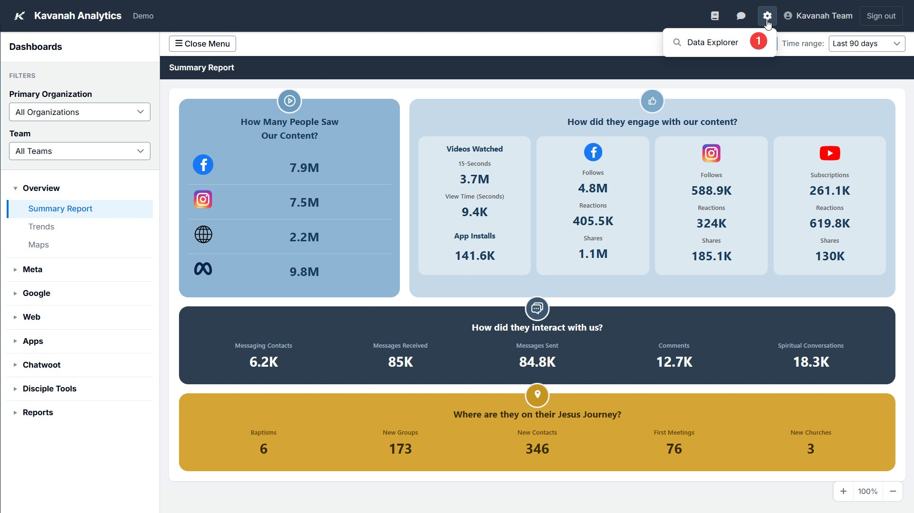
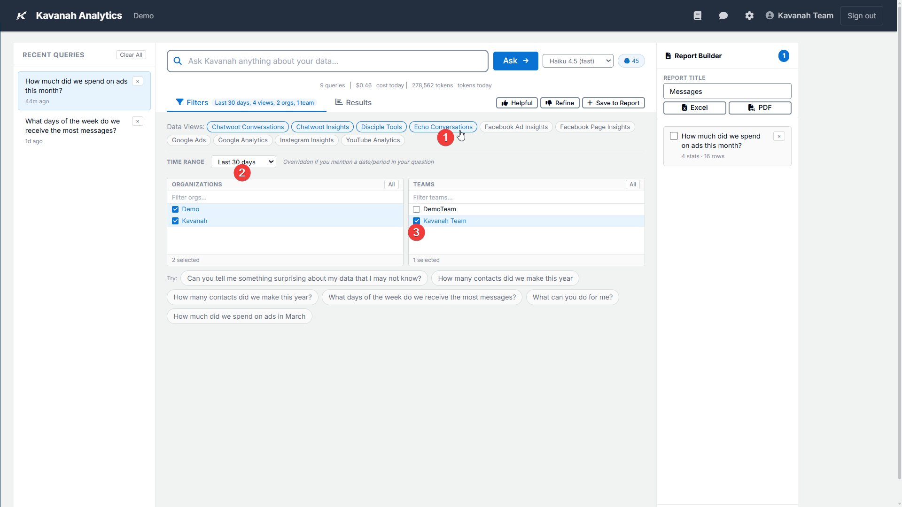
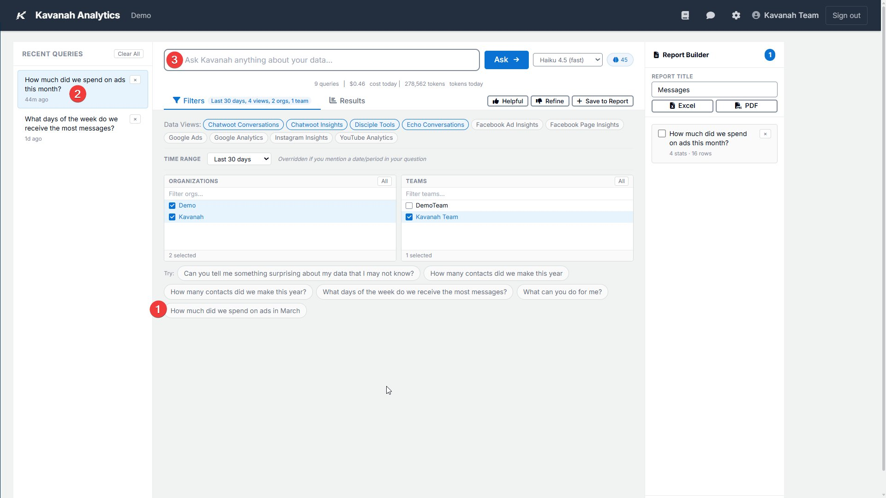
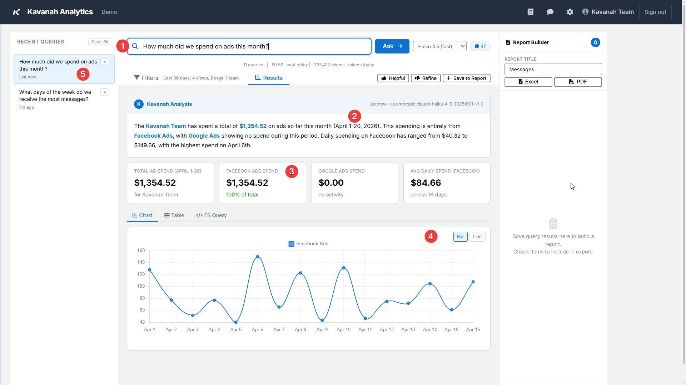
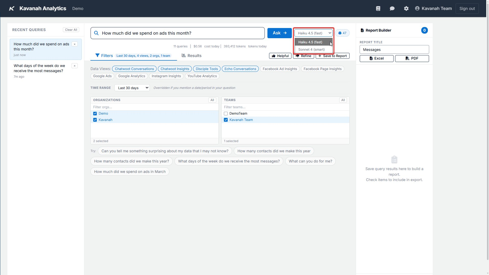
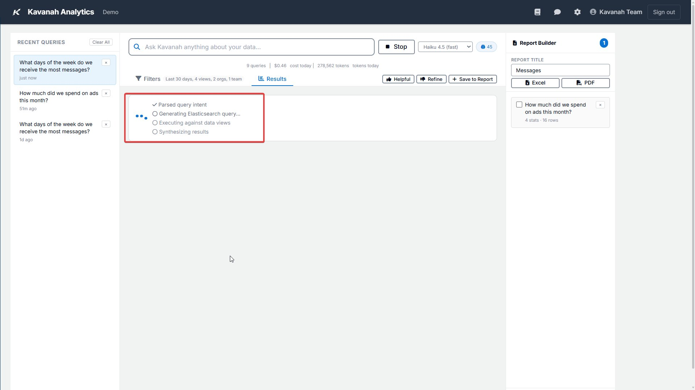
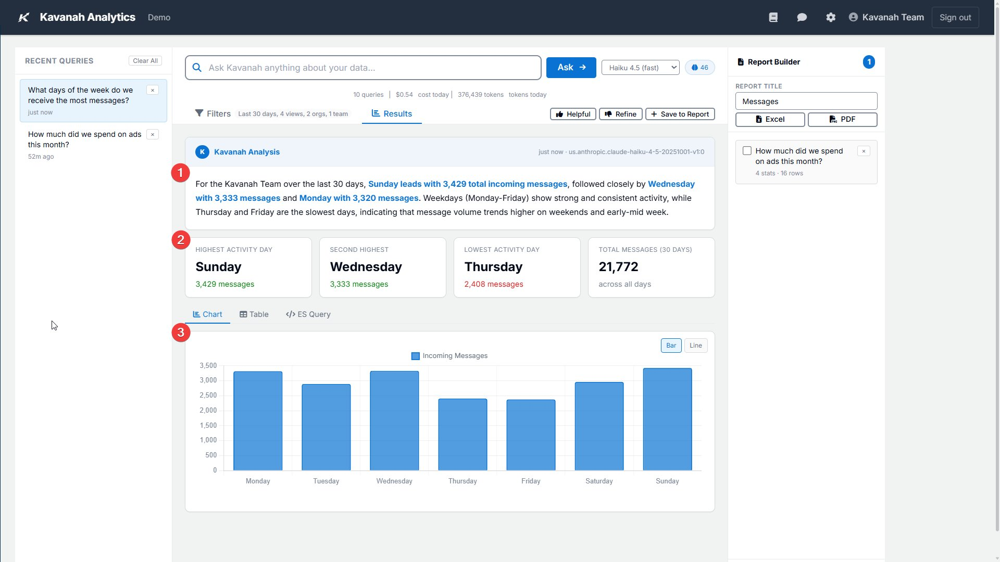
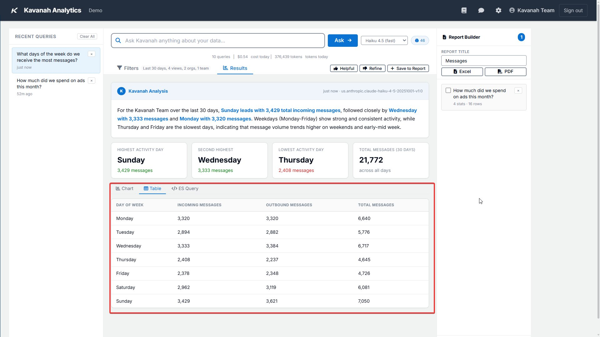
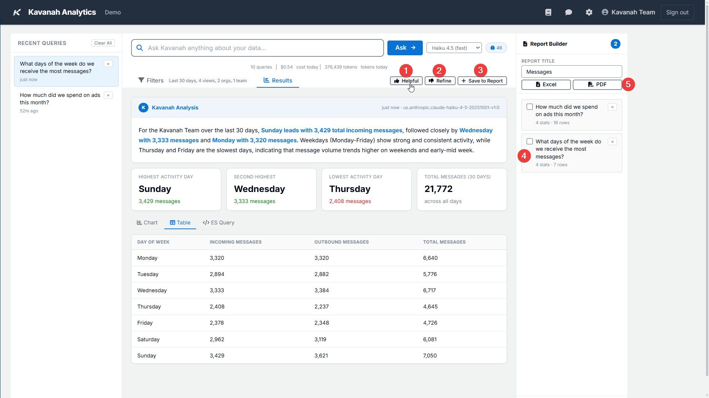

.. _guide-data-explorer-overview:

==============================
How To Use the Data Explorer
==============================

Learn how to use the Data Explorer to query specific metrics and generate
actionable insights. This guide walks you through creating custom
visualizations and exporting reports for your team.

.. note::

   Your data stays private. Every query and result is processed entirely
   within your Kavanah Analytics environment — nothing is sent to external
   servers. The AI models run within the same secure infrastructure, so your
   data never leaves your instance.

Access the Data Explorer
------------------------

You need the **Data Explorer** permission (``mc_data_explorer`` or
``db_data_explorer``) to use this feature — if you don't have it, the
link won't appear. Both ``asset_admin`` and ``superuser`` have it by
default, and a superuser can grant it to any custom role from User
Management.

To open the Data Explorer:

- From the **Dashboards** page, click the **Data Explorer** entry-point
  link if it's enabled, or
- Open the gear menu in the top-right and pick **Data Explorer** from the
  Management Console.

Set Query Filters
-----------------

Click the **Filters** tab above the query box to open the filter panel.
Setting filters is optional — without them the model picks sensible
defaults — but the more specific you are, the more focused the
results.

The Filters panel has four controls:

- **Data Views** — inline pills showing the data sources available to
  you (Facebook Ads, Instagram, Google Ads, YouTube, Echo, Chatwoot,
  Disciple Tools, etc.). Click a pill to toggle it on or off. The
  first three are selected by default; the label shows
  *"Data Views: (all)"* when everything is on.
- **Time Range** — dropdown with preset windows: Last 7 days, Last 30
  days (default), Last 90 days, Last 6 months, Last 12 months,
  Year-to-date, and All time.
- **Organizations** — searchable listbox with an **All** toggle. Tick
  the orgs you want the query scoped to.
- **Teams** — same UX as Organizations.

A small counter on the **Filters** tab shows how many filters are
currently active.

*(1) Data Views to include. (2) Time Range. (3) Organizations.
(4) Teams.*

Choose or Write a Query
-----------------------

There are three ways to start a query:

- **Sample queries** ("Try:" chips) sit at the bottom of the Filters
  panel. Click one to populate the query box and run it. The samples
  are learned from your previous successful queries; if you haven't run
  any yet, you'll see a default set ("Compare ad spend across
  channels", "Top 5 campaigns by ROI", etc.).
- **Recent Queries** in the left sidebar saves your last 50 queries.
  Click any item to re-run it. Hover for the **×** button to remove a
  single query, or click **Clear All** at the top of the panel to
  wipe the history.
- **Custom query** — type your question in the search bar at the top of
  the page. There's no specific format; the AI model translates natural
  language into Elasticsearch queries.

*(1) Sample queries at the bottom of the Filters panel. (2) Recent
Queries panel with × delete and Clear All. (3) Search bar for writing a
custom query.*

Writing effective queries
~~~~~~~~~~~~~~~~~~~~~~~~~

You don't need to follow a specific format — the AI model interprets natural
language and maps your question to the right data. That said, clearer
questions produce better results. Avoid vague phrasing and be specific about
the metric, time frame, or comparison you're looking for.

For example, *"How much did we spend on ads this month?"* works well because
it identifies a clear metric (ad spend) and a time frame (this month). The
model automatically selects the relevant data sources and overrides the date
filter when your question specifies a period.

*(1) The query entered in the search bar. (2) The AI narrative summarizing
the results. (3) Key metrics pulled from the matching data view. (4) A chart
visualization of the results. (5) The query is automatically saved to Recent
Queries.*

Select a Model
--------------

The model dropdown next to the search bar offers two options:

- **Haiku 4.5 (fast)** — handles most queries quickly and is the
  cheapest to run.
- **Sonnet 4 (smart)** — slower and more expensive, but better at
  multi-step reasoning when Haiku doesn't get there.

Start with Haiku and switch to Sonnet only if you need it.

.. note::

   The underlying provider — Anthropic API or AWS Bedrock — is
   configured server-side by your administrator. Sonnet may be hidden
   if your deployment hasn't enabled it.

Usage stats
~~~~~~~~~~~

A small counter near the query bar tracks today's usage: the number of
queries you've run, an estimated cost, and total tokens consumed. Use
it to keep an eye on API costs, especially when running Sonnet.

Query Execution
---------------

The average time for a query is 15–30 seconds. If the query is pulling from
several data sources or searching over a long time period, it may take a few
minutes. You can click the **Stop** button next to the query field if you
want to change the query parameters and try again.

Review the Results
------------------

When the query completes, you will see:

- A narrative description of the results
- Key metrics
- A bar chart (if applicable)

*(1) Narrative description of the results. (2) Key metrics. (3) Bar chart of
the results — toggles to switch between Line, Table, and ES Query views.*

You can also switch views:

- Click **Line** to see a trend line.
- Click **Table** to view results in table format.
- Click **ES Query** to view the actual Elasticsearch query the model
  formulated, formatted as a Kibana Dev Tools snippet (e.g.
  ``GET /index/_search`` followed by the JSON body). Click **Copy for
  Dev Tools** to copy the snippet to your clipboard — paste it directly
  into Kibana's Dev Tools console to inspect or modify the raw query.

*Click Table to view the results in a table format.*

Provide Feedback
----------------

Use the **Helpful** and **Refine** buttons to provide feedback to the model.
The Data Explorer saves this feedback and uses it to guide the model for
improved future queries.

Save and Export Reports
-----------------------

Click **Save to Report** to add the results to the Report Builder section.
From there:

- Click the checkbox next to a saved report to include it in the export.
- Type in a name for the report.
- Select either Excel or PDF to export.
- To remove a saved report, click the **X** in the upper right corner.

*(1) Click the Helpful button or (2) Refine button to give feedback on the
model results. (3) Save to Report adds the report to the Report Builder.
(4) Click the checkbox to include a saved report in the export. (5) Enter
the Report Title and click Excel or PDF to export. The X in the upper right
removes a saved report.*

.. tip::

   - Start with the Haiku model for cost efficiency, and switch to Sonnet
     only when needed.
   - Use the sample queries as a starting point to understand what types of
     questions the Data Explorer can answer.
   - Provide feedback using the Helpful and Refine buttons to improve future
     query results.
