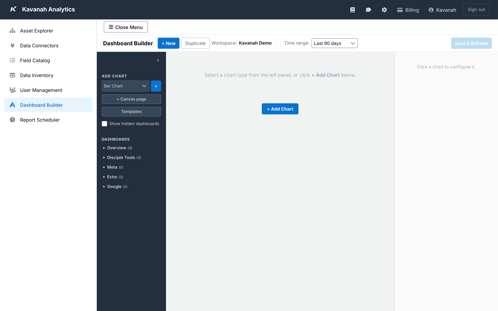

.. _guide-management-console-dashboard-builder:

=================
Dashboard Builder
=================

The **Dashboard Builder** is Kavanah Analytics' no-code, drag-and-drop
tool for creating custom analytics dashboards. You pull data from any of
your connected data sources, arrange charts on a canvas, and save the
result so your team can open it from the Dashboards menu.

Open it from the Management Console sidebar. You need a role with the
**Dashboard Builder** permission (``mc_dashboard_builder``) to build
dashboards — ``asset_admin`` and ``superuser`` have it by default, and
a superuser can grant it to a custom role from the User Management
page. Any authenticated user can view the dashboards you save (subject
to the dashboard's own *Visibility* setting, see below).

This guide walks you through the common workflows — creating a new
dashboard, adding and configuring charts, saving and sharing it, and
publishing an Impact Report to a public URL.

For a reference-style tour of every chart type, aggregation, and filter
option, see :doc:`/dashboards/dashboard-builder`.

----

The builder layout
==================

Dashboard Builder has three areas:

.. code-block:: text

   ┌─────────────────┬──────────────────────────────┬──────────────────┐
   │  LEFT PANEL     │  CANVAS                      │  RIGHT PANEL     │
   │                 │                              │                  │
   │  Add Chart      │                              │  Chart Info      │
   │  Templates      │  (your charts go here)       │  Data & Fields   │
   │  Dashboards     │                              │  Aggregation     │
   │                 │                              │  Display Toggles │
   └─────────────────┴──────────────────────────────┴──────────────────┘

The **toolbar** along the top holds the **+ New** and **Duplicate**
buttons, the **Workspace** selector, the **Time range** picker, and the
**Save & Refresh** button. The toolbar controls affect the dashboard as
a whole; the right-panel controls affect the chart you currently have
selected.

         Workspace selector, Time range, Save & Refresh), the left
         panel (Add Chart dropdown, Templates button, and the
         Dashboards explorer), an empty canvas prompting "+ Add
         Chart", and the right panel prompting you to select a chart.

----

Creating a dashboard
====================

1. Click **+ New** in the toolbar.
2. Enter a title in the dialog. Keep it short — this is what your team
   will see in the dashboards menu.
3. Click **Create**.

Kavanah creates a blank dashboard, adds it to the **Dashboards**
explorer in the left panel, and selects it so you can start adding
charts. Until you save, nothing is persisted — **Save & Refresh** in the
toolbar becomes enabled as soon as you make a change.

.. tip::

   To edit an existing dashboard, open it from the **Dashboards**
   explorer in the left panel. It opens in edit mode ready for changes.

.. note::

   If you click **+ New** (or pick a different dashboard) while you
   have unsaved changes, Kavanah pops up a *"You have unsaved changes"*
   dialog with three options: **Save First**, **Discard**, or
   **Cancel**. Discarding throws away every edit since the last save.

----

Adding charts
=============

There are three ways to add a chart to the canvas.

From the dropdown
-----------------

1. In the left panel, pick a chart type from the dropdown:

   - **Bar Chart** — grouped bars (multi-series with breakdown)
   - **Line Chart** — trends over time or category comparisons
   - **Pie Chart** — proportional breakdown by category
   - **Table** — tabular data with configurable columns
   - **Metric / KPI** — a large single value
   - **Grouped Table** — a styled table with row/column groups
   - **Geographic Map** — a dot map of reach or engagement

2. Click the **+** button next to the dropdown.

The new chart appears on the canvas. It won't render until you configure
its data — keep reading.

From templates
--------------

Click **Templates** in the left panel for a small library of
pre-configured, full-page reports. Today the modal offers four
templates:

- **Facebook Digital Impact Report** — full-page report with KPI cards,
  engagement funnel, geographic reach map, and monthly trends, scoped
  to your Facebook Ads data.
- **Combined Digital Impact Report** — the same layout, but combining
  Facebook Ads and Google Ads into unified totals.
- **Google Digital Impact Report** — Google Ads-only version of the
  same layout.
- **Summary Report** — a four-section visual ("Reach", "Engagement",
  "Interaction", "Jesus Journey") suitable for printing or embedding
  in a Canva-style supporter update.

Click a template tile to drop it on the canvas with its charts and
formatting already wired up. You can then tweak it from the right
panel like any other chart.

.. note::

   Templates are designed as standalone reports — start with a fresh
   dashboard and pick one template, rather than mixing them with
   regular bar/line/pie charts.

By dragging
-----------

Drag the chart type entry from the left panel directly onto the canvas.
This is the fastest way if you know you want a specific type in a
specific position.

----

Configuring a chart
===================

Click any chart to select it. The right panel refreshes to show that
chart's settings. Most charts share the same top-level sections:

**Chart Info**
   The chart's **Title** and **Type**. Change the type here to convert
   between bar/line/pie/table/metric without recreating the chart.

**Data & Fields**
   The **Data View** (which Elasticsearch index to query), the **X
   Field** (the category or date axis), and the **Y Fields** (one or
   more numeric fields). An optional **Breakdown** field splits each
   X-axis bucket into a multi-series chart.

**Aggregation**
   How to combine values that share the same X value: **Sum** (default
   for most metrics like spend or impressions), **Average**, **Min**,
   **Max**, **Count**, or **Unique** (count of distinct values).

**Date Format** *(when X is a date)*
   How to label date ticks — *Auto*, *Mon YYYY*, *YYYY-MM*, and a few
   other formats.

**Y Axis Scale** *(bar and line charts only)*
   Override the auto-fit min/max so charts share a consistent scale
   across a dashboard.

Working with tables
-------------------

Tables are a little different — instead of X/Y fields, you configure
rows and columns explicitly.

1. In the **Columns** section, set the **Row Labels Title** (e.g., *Team*)
   and **Row Labels Field** — this becomes the first column of the
   table.
2. Optionally add a **Sub-Row** by setting a title and field — the
   table becomes two-level.
3. Set **Max Rows** to cap the result size.
4. Click **+ Add Column** to add a data column. For each column, pick
   the field, aggregation, and format.
5. Click **↻ Refresh & Save** to render the table with your latest
   changes.

Working with grouped tables
---------------------------

Grouped Tables are used for Impact Report summary cards where several
metrics are arranged under coloured group headers. The right panel
exposes extra styling controls — title row colour, group header colour,
column header colour, header text colour, and font sizes. Use the
**Groups & Columns** editor to define each group and the columns it
contains, then click **↻ Refresh & Save**.

Working with geographic maps
----------------------------

Maps work off a **Statistic** (for example, *Reach*) that can be
composed of several fields across different data views. For each
metric you want to include:

1. In the **Display Metric** dropdown, pick an existing statistic or
   create a new one.
2. Under **Field Configuration**, click **+ Add Field** and set its
   **Label**, **Data View**, **Field**, and **Aggregation**. Add more
   fields to the same metric to blend data sources.
3. Use **− Remove Field** to drop a field you no longer need.

The map renders once at least one field is set. It draws three layers
on top of the base tiles: country dots, region (admin-1) polygons
shaded by value, and city dots — all sized in proportion to the
metric.

Toggle **Show location names** in the map's right-panel config to
overlay the country / region / city names on the map. This is helpful
for printable reports but can clutter the screen on busy maps — leave
it off for interactive use.

Working with Impact Reports
---------------------------

When you click an Impact Report chart from a Templates-built dashboard
(Facebook, Google, or Combined), the right panel opens an **Impact
Report** config block:

- **Organization Name** — text field. Whatever you type here appears as
  the header at the top of the rendered report. Set it to the org or
  campaign name you're reporting on.
- **Show location names on geographic reach** — checkbox. Same effect
  as the map toggle above, but scoped to the report's geographic-reach
  panel. Turn it on for printed reports, off for interactive viewing.
- **Metrics editor** — list of the four headline KPIs that drive the
  cards at the top of the report. Add, remove, or reorder them; for
  each, pick the data view, field, and aggregation. Click
  **↻ Refresh** at the bottom to re-render the report after a change.

Display toggles
---------------

After any chart renders, the right panel adds a **Display Toggles**
section: one checkbox per series (for line, bar, or pie charts) or per
column (for tables). Untick a series to hide it from the chart without
removing it from the underlying data — useful when one outlier
dominates the scale, or when you want to focus on a single campaign.

Toggle state is saved as part of the dashboard, so the chart remembers
your selections the next time it loads.

----

Dashboard-wide settings
=======================

The toolbar and the **Dashboard Properties** section (on the right
panel when you select the dashboard in the explorer, not a chart)
control settings that apply to the whole dashboard.

Time range
----------

Pick a preset from the **Time range** dropdown in the toolbar — *All
time*, *Last 7 days*, *Last 30 days*, *Last 90 days* (default), *Last 6
months*, *Last 12 months* — or select **Custom range...** and set specific
dates. The range applies to every chart whose X field is a date.

Custom ranges accept dates from your earliest data through today —
future dates and end-before-start ranges are blocked. The **Apply**
button stays disabled until both fields hold a valid date and the
end is on or after the start.

Individual charts can override the global range from their own config
if you need to.

Org and Team filters
--------------------

Use the **Org** and **Team** dropdowns in the toolbar to limit the
dashboard to a specific organisation or team's data. This is useful for
checking what a client will see, or for building a dashboard that's
naturally scoped to one group.

Visibility
----------

In **Dashboard Properties**, pick a **Visibility** mode:

- **Show All** — any authenticated user can open the dashboard
- **Show Teams** — only users assigned to the organisations or teams
  you select (multi-select lists appear below when you choose this
  option)
- **Hidden** — only administrators see it

Click **Save Properties** when you're done.

Menu placement
--------------

Dashboards are grouped in the sidebar by their **menu** value (Reports
or Maps). Most dashboards you build belong in Reports — the default.
Maps is reserved for geographic-map dashboards.

----

Saving
======

Click **Save & Refresh** in the toolbar. Kavanah stores the dashboard
and all its charts in the ``de_asset_echarts_dashboards`` index in
Elasticsearch, then re-queries every chart with the current toolbar
filters.

It's worth clicking this regularly as you work — each save is a
checkpoint you can come back to.

----

Viewing a saved dashboard
=========================

Every saved dashboard has a viewer URL at
``/dashboard-builder/view/<dashboard_id>``. This is the URL non-admin
users follow from the Dashboards menu. The viewer shows the charts
only — no builder controls — with the toolbar reduced to the time range
picker, **Export** button, and (for eligible dashboards) **Publish**
button.

Users who are restricted to a specific org or team have their data
filtered automatically; they see the dashboard but only with data
they're authorised to view.

Exporting
---------

On the viewer, click **Export** to open the **Export Dashboard** dialog.
Enter a title (this becomes the filename), pick a format — **Excel
(.xlsx)** (default), **CSV**, or **PDF** — and click **Export**.

----

Publishing an Impact Report
===========================

Digital Impact Reports can be published to a public URL that anyone
can open without a Kavanah login. This is handy for embedding a live
report in a newsletter, sending a board member a phone-friendly link,
or including it in a fundraising appeal.

The full walkthrough is at :doc:`/guide-dashboards/sharing-reports`.
The short version:

1. Open the dashboard in the **viewer** (not the builder).
2. Click **Publish** on the toolbar, then **Generate Link** in the
   dialog.
3. Click **Copy** to copy the URL, then paste it wherever you're
   sharing it.

The **Publish** button only appears when the dashboard is eligible.
It's eligible when all of the following are true:

- It's a dashboard built with this builder
- Its menu is **Reports**
- It contains only Impact Report charts (Facebook, Google, or
  Combined)
- It has at least one organisation or team assigned in its properties

If any of those conditions isn't met, the dialog explains which
requirement is missing.

**Regenerate** rotates the URL (the old one stops working immediately).
**Remove Link** revokes the URL — anyone who had it will see a *"This
report is not available"* page.

----

Common workflows
================

Building a team performance dashboard
-------------------------------------

1. Click **+ New** and name it ("Marketing Team — Weekly").
2. In **Dashboard Properties**, set **Visibility** to **Show Teams**
   and pick the team that will view it.
3. Add a **Metric / KPI** chart for reach: Data View *Facebook Ads
   Insights*, Y field *impressions*, Aggregation *Sum*.
4. Add a **Line Chart** for spend over time: X field *date*, Y field
   *spend*, Aggregation *Sum*, optional Breakdown by *campaign_name*.
5. Add a **Table** for top campaigns: Row Labels *campaign_name*,
   columns for *spend*, *clicks*, and *CTR*.
6. Click **Save & Refresh** between changes so you don't lose work.

Turning a dashboard into a monthly supporter update
---------------------------------------------------

1. Build the dashboard with Impact Report charts only (Facebook,
   Google, and/or Combined).
2. Make sure its menu is **Reports** and it has an organisation or
   team assigned.
3. Open it in the viewer and click **Publish** → **Generate Link**.
4. Include the URL in your supporter newsletter. When you send a new
   one, you can either share the same URL (the data updates
   automatically) or click **Regenerate** to rotate the link.

----

Related pages
=============

- :doc:`/dashboards/dashboard-builder` — reference for every chart
  type, aggregation, filter operator, and breakdown option
- :doc:`/guide-dashboards/sharing-reports` — full walkthrough of
  publishing, regenerating, and revoking shareable report URLs
- :doc:`/guide-dashboards/overview` — what the dashboards page looks
  like from a viewer's perspective
